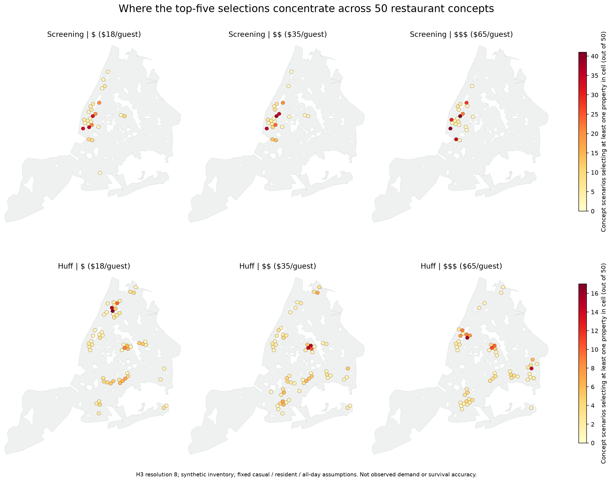

# November 2 Model Results - Team Handoff

## Open The Heatmaps

This is a **separate offline results viewer**, not a dashboard deployment.

1. Download or pull the `otis-week-10` branch.
2. Open `reports/2026-11-02-model-results/maps/heatmaps.html` in Chrome, Safari or Firefox.
3. Choose a concept, price tier and screening/Huff ranking. The all-concepts view shows selection-frequency H3 cells; a specific concept shows its five ranked properties.

No Flask server, Python environment, API key, tile downloads or private data folder is needed to view the exported results. GitHub previews HTML as source, not as a running application. Use **Code > Download ZIP** on this branch, extract it, and open the HTML file locally. A separate clone avoids disturbing another teammate's working checkout:

```sh
git clone --branch otis-week-10 --single-branch https://github.com/RumiaKitinari/GroundworkNYC.git Groundwork-Otis-results
```

The main [model update](../../MODEL_UPDATE_FOR_ATHARV_2026-11-02.md) explains what changed and what remains unresolved.

## Briefing Image



Colors count how many concept scenarios selected at least one property in each H3 resolution-8 cell. They do **not** measure observed restaurant demand, verified availability or survival. The screening and Huff rows have separate labeled scales. Map context uses screening-eligible census tracts, not a surveyed shoreline. The complete numerical records are included below.

## Main Results

| Test | Result | Meaning |
| --- | --- | --- |
| Scenario grid | 50 concepts x 3 prices x 1,000 properties | 150,000 scored scenario/property rows |
| Ranking methods | Screening and experimental walking Huff, separately | No new combined weights were fitted |
| Selections | 5 per scenario per method; 1,500 total | Selected only after scoring the full inventory |
| Guest-price response | Top five changed in 85/100 screening and 86/100 Huff adjacent-price comparisons | Recommendations respond to the scenario inputs, not evidence of predictive accuracy |
| First-stage control | 996/1,000 properties have four required dated features | Four remain unscored; the AFT control is cuisine/price-independent |
| Separate cuisine classification | Unavailable for 14 of 50 categories | Keep source-support/fallback warnings visible |
| Conservative competition stress | At least one top-five selection changed for all 50 cuisines at $35 | Unknown-label assumptions can materially change results |
| Verification | 7 unit tests; 300 ranking checks; 241 frequency cells; 600 browser combinations | Output/interaction correctness, not outcome validation |

Default assumptions hold format at casual, audience at residents, and daypart at all day. The prices are $18, $35 and $65 **per guest**, not rent budgets. No rent, property-size or transaction filter is applied in this unconstrained benchmark. All properties are explicitly synthetic. Missing Huff coverage is withheld, not filled with zero; the minimum assessed inventory across scenarios is 705 properties. Screening is an uncalibrated index; Huff values are hypothetical opportunity mass, not observed visits.

## Included Files

- [All scenario scores](scenarios/all_scores.csv.gz), [top-five selections](scenarios/top_selections.csv), [coverage](scenarios/scenario_summary.csv), [price sensitivity](scenarios/price_sensitivity.csv), and [independent checks](scenarios/independent_checks.json).
- [H3 selection-frequency GeoJSON](scenarios/selection_frequency.geojson), [interactive viewer](maps/heatmaps.html), and [briefing image](maps/selection_heatmaps.png).
- [Competition stress summary](competition_stress/results.json), [cuisine comparisons](competition_stress/competition_sensitivity.csv), and [candidate-level comparisons](competition_stress/candidate_sensitivity.csv.gz).
- [First-stage control summary](stage_one_control/results.json), [property-level research predictions](stage_one_control/property_archive_proxy.csv), [joined full scenario outputs](stage_one_control/all_scenarios_with_stage_one.csv.gz), [joined selections](stage_one_control/selected_locations_with_stage_one.csv), and [dated feature provenance](stage_one_control/stage_one_provenance.json).
- [Frozen first-stage evaluation](frozen_stage_one_evaluation/primary_metrics.json), [comparison table](frozen_stage_one_evaluation/primary_results_table.csv), [paired comparisons](frozen_stage_one_evaluation/primary_paired_comparisons.json), and [evaluation figure](frozen_stage_one_evaluation/results_for_briefing.png).
- [Browser checks](checks/browser_checks.json) and [artifact checksums](artifact_manifest.json).

## What These Results Do Not Establish

The saved first-stage model predicts an archive-disappearance proxy, not independently verified permanent restaurant closure. Its dated-core concordance is 0.545 on 2,234 reserved records, with a conditional neighborhood-bootstrap interval of 0.487-0.584. The interval includes 0.5, and these records had earlier project exposure. Capped walkability and wider training did not demonstrate a reliable improvement. Concordance is not percentage accuracy.

The uncertain-competition stress is intentionally conservative: all 4,799 weakly classified, tract-matched active establishments are counted as full competitors, separately for each cuisine. That does not mean these establishments actually serve every cuisine. It is not a statistical confidence interval. Some selection changes reflect additional routing-related withholding. Better labels and defensible uncertainty handling are the next priority, not interpreting recorded scarcity as proven demand.

These exports do not contain raw restaurant training cohorts, account data, credentials, native model files or large routing matrices. The [separate scripts](../../codes/CUISINE_BATCH.md) are included, but rerunning calculations still requires the private pinned input bundles. Viewing and inspecting saved results does not require those bundles. Production model pointers, dashboard code and main are unchanged by this handoff.

## Verify The Downloaded Artifacts

From the repository root, this standard-library-only check confirms the 23 exported data/image artifacts against their recorded checksums:

```sh
python3 -c 'import hashlib,json,pathlib; p=pathlib.Path("reports/2026-11-02-model-results"); m=json.loads((p/"artifact_manifest.json").read_text()); assert all(hashlib.sha256((p/r["path"]).read_bytes()).hexdigest()==r["sha256"] for r in m["artifacts"]); print("All exported artifacts verified")'
```
